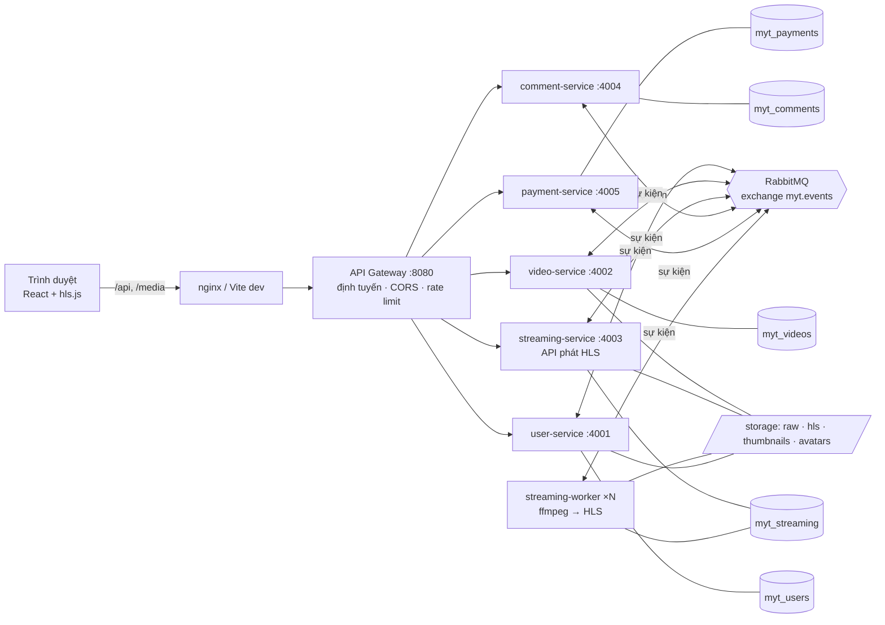

# MiniYTB

Nền tảng xem và chia sẻ video trực tuyến xây dựng theo kiến trúc **microservices**:
tải lên, phát video chất lượng thích ứng, playlist, bình luận/like và gói Premium.

| Tính năng | Chi tiết |
|---|---|
| Tải lên & phát video | Upload đa định dạng → chuyển mã **HLS adaptive bitrate** (360p/480p/720p/1080p) bằng ffmpeg → phát bằng hls.js |
| Playlist | Tạo/sửa/xoá, công khai/riêng tư, phát liên tục cả playlist |
| Bình luận & like | Bình luận + trả lời, like/dislike, bộ đếm đồng bộ qua sự kiện |
| Tài khoản | Đăng ký/đăng nhập JWT, Google OAuth, quên mật khẩu qua email, hồ sơ, avatar |
| Khám phá | Tìm kiếm, thẻ, thịnh hành, video liên quan, lịch sử xem có "xem tiếp" |
| Kênh & Studio | Trang kênh, quản lý video, theo dõi tiến trình chuyển mã |
| Premium | Gói trả phí, xem 1080p, upload file lớn hơn; cổng VNPay (sandbox) và cổng thử nghiệm |
| Quản trị | Kiểm duyệt video có xem trước, quản lý người dùng, doanh thu, sức khoẻ các service |

| Service | Trách nhiệm |
|---|---|
| Gateway | Điểm vào duy nhất: định tuyến, CORS, rate limit, health tổng hợp |
| User Service | Đăng ký/đăng nhập JWT, Google OAuth, quên mật khẩu, hồ sơ, quản trị user |
| Video Service | Metadata, kiểm duyệt, tìm kiếm, thịnh hành, playlist, lịch sử xem, đếm view chống spam |
| Streaming Service | Worker chuyển mã (scale ngang) + API phát video có kiểm tra quyền & giới hạn chất lượng theo gói |
| Comment Service | Bình luận, phản hồi, reaction |
| Payment Service | Gói Premium, đơn hàng, VNPay sandbox + cổng thử nghiệm, kích hoạt idempotent |

---

## 1. Kiến trúc



**Nguyên tắc thiết kế**

- **Database-per-service**: mỗi service một database MongoDB riêng, không service nào đọc DB của service khác.
- **Giao tiếp bất đồng bộ qua sự kiện** (RabbitMQ topic exchange, queue bền vững, dead-letter queue `myt.dead`).
- **Event-carried state transfer**: streaming-service và comment-service giữ bản sao trạng thái video (read model),
  nên khi phát từng segment video hay đăng bình luận không phải gọi đồng bộ sang video-service.
- **JWT không trạng thái**: mọi service tự xác thực token bằng `JWT_SECRET` chung. Token mang theo tên, avatar và gói dịch vụ.
- **Scale ngang**: nhiều instance của cùng service dùng chung queue, nên RabbitMQ tự chia tải.
  Ví dụ `docker compose up -d --scale streaming-worker=3`.

### Luồng tải lên & phát video

1. `POST /api/videos` (multipart): video-service lưu file gốc, tạo bản ghi `queued`, phát **`video.uploaded`**.
2. streaming-worker nhận việc (mỗi worker 1 việc/lần): ffprobe, rồi ffmpeg **một lần decode** tách thành nhiều độ phân giải
   (`split` + `var_stream_map`), phát **`video.transcode.progress`** theo từng 5%.
3. Xong việc: phát **`video.transcoded`**. video-service chuyển sang `ready`, chờ admin duyệt
   (hoặc tự duyệt nếu `AUTO_APPROVE_VIDEOS=true` hay người đăng là admin).
4. Mỗi lần đổi trạng thái, video-service phát **`video.state`**. streaming-service và comment-service cập nhật read model.
5. Trình phát gọi `GET /api/stream/:id/master.m3u8` kèm JWT. Master playlist được **lọc theo gói**:
   khách và tài khoản free tối đa 720p, Premium xem được 1080p. Request segment 1080p của tài khoản free bị trả 403.

### Danh mục sự kiện

| Sự kiện | Phát bởi | Nhận bởi | Mục đích |
|---|---|---|---|
| `user.updated` | user | video, comment | Đồng bộ tên/avatar chủ kênh, người bình luận |
| `user.deleted` | user | video, comment, payment | Dọn video, playlist, lịch sử, bình luận, reaction, đơn chờ |
| `video.uploaded` | video | streaming-worker | Yêu cầu chuyển mã |
| `video.transcode.progress` / `video.transcoded` / `video.transcode.failed` | streaming-worker | video | Tiến trình & kết quả chuyển mã |
| `video.state` | video | streaming, comment | Read model quyền xem (hiển thị, duyệt, xử lý) |
| `video.approved` | video | (dự phòng: thông báo) | Video được duyệt |
| `video.deleted` | video | streaming, comment | Xoá file HLS, thumbnail, bình luận, reaction |
| `comment.created` / `comment.deleted` | comment | video | Bộ đếm bình luận |
| `reaction.changed` | comment | video | Bộ đếm like/dislike |
| `payment.succeeded` | payment | user | Nâng cấp Premium (+ email chào mừng) |

---

## 2. Chạy trên máy (local)

**Yêu cầu:** Docker Desktop. Nếu chạy bằng Node thì cần thêm Node.js ≥ 20.6 và `ffmpeg` trong PATH.

### Cách A — Toàn bộ bằng Docker (một lệnh)

```bash
cp .env.example .env          # tuỳ chọn: compose có giá trị mặc định
docker compose up -d --build
npm run seed                  # (tuỳ chọn) tạo dữ liệu demo — cần Node + ffmpeg trên máy
```

### Cách B — Hạ tầng bằng Docker, service chạy bằng Node (tiện khi sửa code, tự reload)

```bash
cp .env.example .env
npm install
npm run infra:up              # mongo + rabbitmq + mailpit
npm run dev                   # 6 service + frontend (Vite)
npm run seed                  # (tuỳ chọn) dữ liệu demo
```

> Hai cách dùng chung MongoDB và thư mục `./storage`, nên dữ liệu tạo ở cách này vẫn thấy ở cách kia.
> Đừng chạy cả hai cùng lúc vì trùng cổng.

### Địa chỉ

| | URL |
|---|---|
| Ứng dụng | http://localhost:5173 |
| API Gateway (+ `/api/health` tổng hợp) | http://localhost:8080/api/health |
| RabbitMQ Management | http://localhost:15672 (guest / guest) |
| Mailpit (hộp thư test, email quên mật khẩu) | http://localhost:8025 |

### Tài khoản

| Vai trò | Email | Mật khẩu |
|---|---|---|
| Admin (tự tạo khi khởi động) | `admin@local.test` | `admin12345` |
| Demo (sau `npm run seed`) | `lan@demo.local`, `minh@demo.local` | `password123` |

### Kiểm thử

```bash
npm test          # unit test: chữ ký VNPay, chọn độ phân giải, chặn path traversal...
npm run smoke     # end-to-end qua gateway: đăng ký → upload → chuyển mã → duyệt → phát HLS
                  # → chặn 1080p → view → bình luận/like → playlist → thanh toán → 1080p → xoá & dọn dữ liệu
```

---

## 3. Cấu trúc thư mục

```
MiniYTB/
├── docker-compose.yml          # hạ tầng + 6 service + worker + frontend
├── docker/service.Dockerfile   # Dockerfile chung (build arg SERVICE)
├── packages/common/            # dùng chung: env, JWT, Express app, Mongo, RabbitMQ bus, storage
├── services/
│   ├── gateway/                # reverse proxy, CORS, rate limit, health tổng hợp
│   ├── user-service/           # auth, users, admin users, Google OAuth, email
│   ├── video-service/          # videos, playlists, history, admin videos, views
│   ├── streaming-service/      # api.js (phát HLS) + worker.js / ffmpeg.js (chuyển mã)
│   ├── comment-service/        # comments, reactions
│   └── payment-service/        # plans, orders, mock gateway, VNPay
├── frontend/                   # React 19 + Vite + Tailwind + hls.js (nginx khi chạy Docker)
├── scripts/                    # smoke-test.mjs, seed.mjs
└── storage/                    # file media khi chạy local (không commit)
```

## 4. API chính (qua gateway, tiền tố `/api`)

| Service | Endpoint |
|---|---|
| user | `POST /auth/register` `POST /auth/login` `POST /auth/forgot-password` `POST /auth/reset-password/:token` `GET /auth/google` · `GET/PUT/DELETE /users/me` `POST /users/me/avatar` `PUT /users/me/password` `GET /users/:id` · `GET /admin/users` `PUT /admin/users/:id/role` `PUT /admin/users/:id/status` `DELETE /admin/users/:id` |
| video | `GET /videos?search&tag&owner&sort` `GET /videos/trending` `GET /videos/tags` `GET /videos/mine` `GET /videos/batch?ids` `GET /videos/:id` `GET /videos/:id/related` `POST /videos` `PUT/DELETE /videos/:id` `POST /videos/:id/thumbnail` `POST /videos/:id/retry` `POST /videos/:id/view` · `GET/POST /playlists` `GET /playlists/mine` `GET/PUT/DELETE /playlists/:id` `POST /playlists/:id/videos` `DELETE /playlists/:id/videos/:videoId` · `GET/POST/DELETE /history` · `GET /admin/videos` `GET /admin/videos/stats` `PUT /admin/videos/:id/approve` `PUT /admin/videos/:id/reject` |
| streaming | `GET /stream/:id/info` `GET /stream/:id/master.m3u8` `GET /stream/:id/:rendition/:file` · `GET /media/{thumbnails,avatars,images}/*` |
| comment | `GET /comments?videoId&sort` `GET /comments/:id/replies` `POST /comments` `PUT/DELETE /comments/:id` · `GET/PUT /reactions/:videoId` `GET /reactions/mine/liked` |
| payment | `GET /payments/plans` `POST /payments/checkout` `GET /payments/orders/:id` `POST /payments/orders/:id/cancel` `POST /payments/mock/:id/complete` `GET /payments/vnpay/return` `GET /payments/vnpay/ipn` `GET /payments/mine` `GET /payments/subscription` · `GET /admin/payments` |

## 5. Deploy

- **Render:** làm theo [DEPLOY-RENDER.md](DEPLOY-RENDER.md). Blueprint [render.yaml](render.yaml) tạo toàn bộ hệ thống: 6 web service free, 1 worker, 1 static site. Dịch vụ ngoài cần có: MongoDB Atlas, CloudAMQP, Cloudflare R2, Brevo.
- **Một VM bất kỳ** (Azure/GCP/AWS): `docker compose up -d --build` với `.env` đã điền secret thật. Có thể giữ `STORAGE_DRIVER=local`.

Các biến môi trường quan trọng khi deploy:

| Biến | Ý nghĩa |
|---|---|
| `JWT_SECRET` | Bí mật ký token, giống nhau ở mọi service (`openssl rand -hex 32`) |
| `INTERNAL_TOKEN` | Bí mật gateway ↔ service; service từ chối request không qua gateway |
| `MONGO_URL` / `RABBITMQ_URL` | MongoDB Atlas / CloudAMQP |
| `STORAGE_DRIVER=s3` + `S3_*` | Lưu file trên object storage (bắt buộc khi các service chạy ở máy khác nhau) |
| `GATEWAY_PUBLIC_URL` | URL public của gateway: dùng tạo URL ảnh tuyệt đối, Google/VNPay callback |
| `FRONTEND_URL`, `CORS_ORIGINS` | Domain frontend |
| `VITE_GATEWAY_URL` | (build frontend) URL gateway khi frontend nằm ở domain khác |
| `BREVO_API_KEY` hoặc `SMTP_*` | Gửi email |
| `PAYMENT_MOCK_ENABLED`, `VNPAY_*` | Cổng thanh toán |
| `MAX_RENDITION_HEIGHT`, `FREE_MAX_HEIGHT`, `FFMPEG_PRESET` | Cân chỉnh chuyển mã theo sức máy |

## 6. Hạn chế hiện tại & hướng phát triển

- Sự kiện giao **ít nhất một lần** (at-least-once), nên trong trường hợp hiếm có thể đếm trùng.
  Hướng xử lý: lưu id sự kiện đã xử lý (idempotency key) hoặc dùng outbox pattern.
- Tài khoản bị khoá vẫn dùng token cũ ở các service khác tới khi hết hạn (stateless JWT).
  Hướng xử lý: rút ngắn hạn token + refresh token, hoặc phát sự kiện `user.banned` để các service giữ blocklist.
- Chưa có: theo dõi kênh (subscribe), thông báo (notification-service dùng `video.approved` / `comment.created`),
  phụ đề, livestream, giám sát tập trung (Prometheus/Grafana, ELK), CI/CD, manifest Kubernetes.
